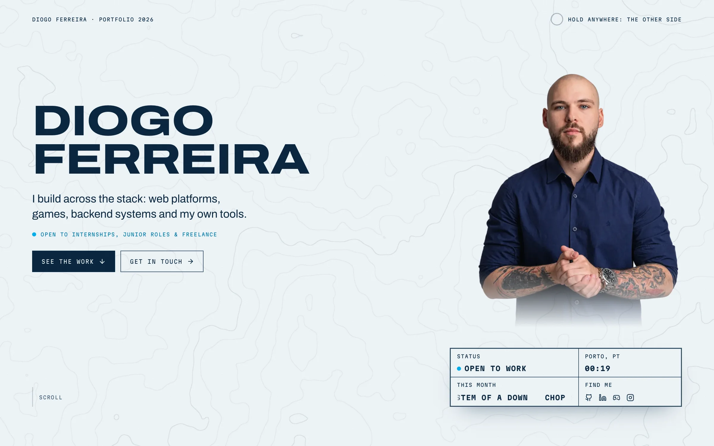

# Diogo Ferreira, personal website

**[diogof146.com](https://diogof146.com)**



My personal website and portfolio, designed and built by me. It's the second version: the first, from March 2026, used Next.js with Tailwind and a shadcn theme, and it worked, but it looked like a lot of other sites. In October 2026 I started over, kept the content, the live data and the terminal idea, and rewrote everything else.

The design is based on the cyanotype, the old blueprint process: deep blue, paper white, and cyan as the light. Project pictures start as blue prints and develop into colour when you hover them, and the page changes colour as you move through the sections. Holding anywhere on the page floods the screen in blue and takes you to the personal side, Off the clock. Before writing the real site I built ten rough prototypes; the second one became the site, and most of the others gave it one piece.

## How it's built

It's Next.js with the App Router, in plain JavaScript, with one CSS Module per component. GSAP runs the motion (ScrollTrigger for anything tied to scrolling, SplitText for the titles, Flip for the archive's filters). Lenis smooths the scroll, and it's off for anyone whose system asks for reduced motion.

The WebGL is written by hand, without a library. The contour lines in the background, the ink that bleeds over a picture on hover, the archive's melt between pictures, the fluid in the side panel, the record on Off the clock, the toolbox shapes and the Porto map are all small fragment shaders, and each one stops drawing when its canvas is off screen.

The live parts (Spotify, Steam, the manga I'm reading, my latest commit, my next exam, Porto's weather) are fetched on the server and cached, and if one of them fails the page shows a fallback instead of an error. The site is in English and European Portuguese, from one JSON file per language. The contact form is a server action that sends the email through Resend, and everything that costs a request is rate limited with Upstash Redis.

Press Cmd+K (or Ctrl+K) on any page to open the terminal: a desktop like a Linux tiling window manager, with a shell, fastfetch, my Steam library, my top artists, a file browser with every project and a guitar tab that plays. The shell has the old site's commands and eight games.

## Project structure

```
src/
├── app/        pages (under [lang]), API routes, sitemap and share images
├── components/ every section and its CSS Module
├── content/    projects, experience, toolbox and the EN/PT text
├── gl/         the WebGL shaders and the shared renderer
├── motion/     scroll reveals and the section colour changes
├── terminal/   the Cmd+K desktop, the shell and its games
├── guitar/     the tab and the synth that plays it
└── lib/        server-side fetching, caching, the contact form and rate limits
```

## Author

[Diogo Ferreira](https://diogof146.com)
